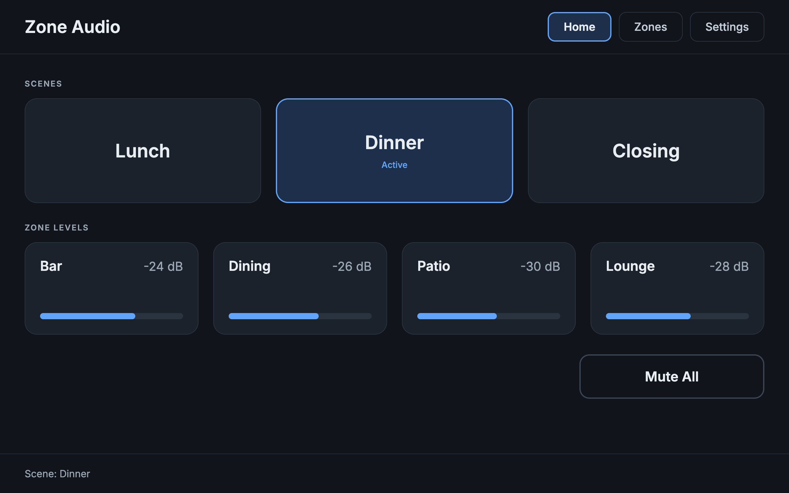
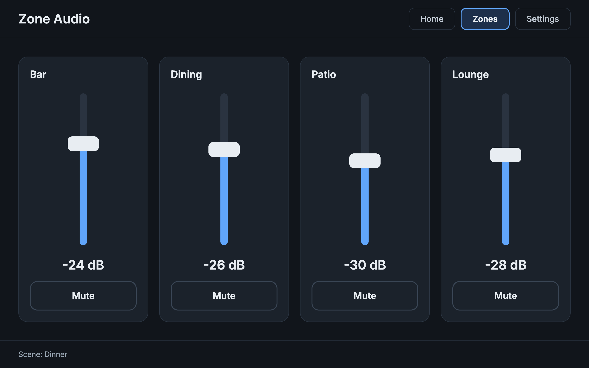
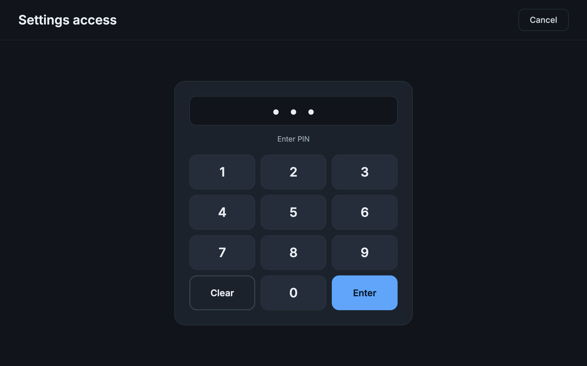

# Q-SYS Multi-Zone Audio UCI (Lua sample project)

#Display images

A second Q-SYS sample: a 4-zone audio panel with scene presets, master mute, and a PIN-protected
settings page. Companion to the single-room example, with a different UCI layout and more
advanced Lua patterns.

## Features

- 4 zones with level and mute, capped at a safety ceiling
- 3 scene presets (Lunch, Dinner, Closing) with active-scene indicators that clear on manual changes
- Master mute that remembers and restores each zone's previous mute state
- PIN-gated Settings page with lockout after repeated bad attempts and an idle auto-return to Home

## Files

| Path | Purpose |
|------|---------|
| `src/zone_audio.lua` | Zone levels/mutes, scenes (data-driven table), master mute |
| `src/uci_nav.lua` | PIN check, attempt lockout, idle timeout, page navigation via `Uci.SetPage` |
| `docs/uci_layout.md` | Page-by-page UCI build guide with control bindings |

## Concepts demonstrated

- Arrayed controls (`Controls.ZoneLevel[i]`) with closure-based handlers in loops
- Data-driven scenes: add a scene by adding a table entry
- Guard flag (`recalling`) to separate scene recall from manual edits
- `pcall(Component.New, ...)` for resilient component lookup
- Multiple `Timer` objects for idle timeout and lockout
- `Uci.SetPage` for script-driven navigation

## Quick start

1. Install Q-SYS Designer (free; Emulate mode needs no hardware).
2. Follow `docs/uci_layout.md` to add the Script components, control pins, gain blocks and UCI.
3. Paste the two scripts in `src/`.
4. Press F5 and open the UCI viewer.

The default PIN is `4321`. Change `CFG.Pin` in `uci_nav.lua` before deploying anywhere real.

## Status

Sample code, untested on a Core. Check API names against your Designer version's Lua reference.

## License

MIT
